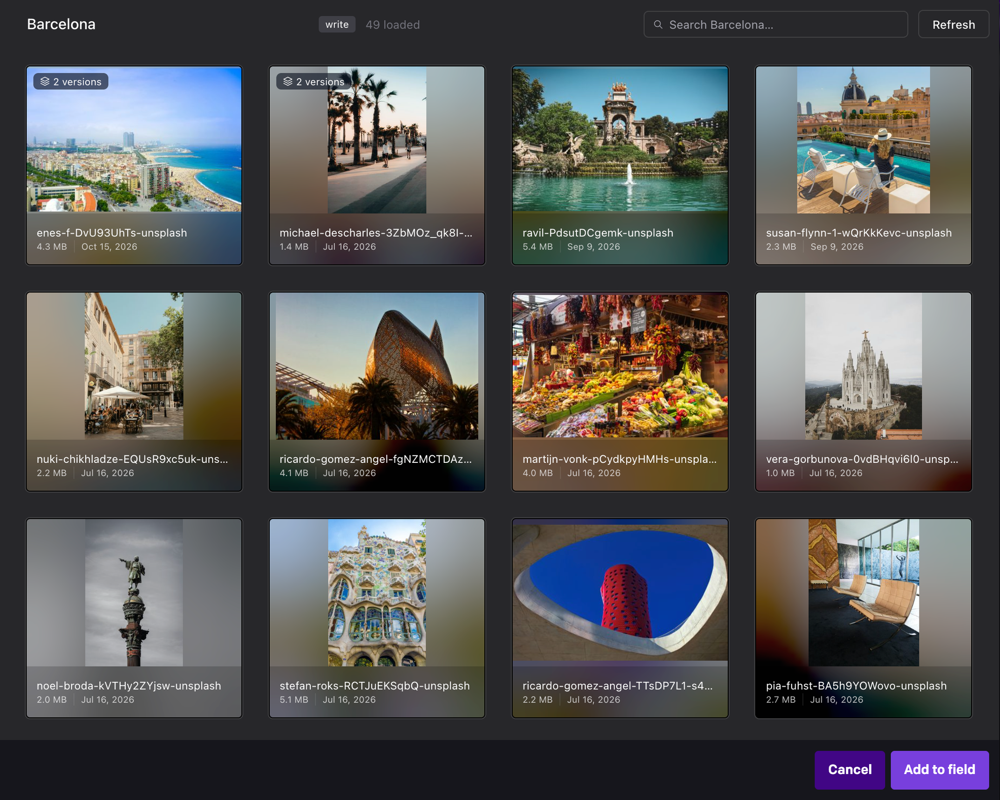

# Raster for DatoCMS

A DatoCMS plugin for [Raster](https://raster.app), a digital asset manager. Browse, search and
upload Raster assets from a record, and pick them into a JSON field.

Built on [`@raster-app/react`](https://www.npmjs.com/package/@raster-app/react), Raster's
drop-in picker. See the [SDK docs](https://raster.app/docs/api/sdk).



## Install and configure

1. In your DatoCMS project, open **Configuration > Plugins**, search the marketplace for
   **Raster** and install it.
2. On a model, add a **JSON** field, or open an existing Raster field. Under **Presentation**,
   choose **Raster** as the field editor.

The plugin's settings are optional:

- **Organization** — your organization's slug, the part after `raster.app/` in its URL. With it
  set, editors can only sign in to that organization.
- **API key for everyone** — an organization API key, created in Raster under
  **Organization settings > API keys**. Editors are then connected without signing in.

## Sign in

The first time an editor clicks **Browse Raster** in a Raster field, the picker asks them to
sign in. **Sign in** opens Raster in a new tab, where they approve the connection; the field
then shows their libraries. The session is remembered in that browser.

If an admin saved an API key, editors skip this step.

The saved key is stored in the plugin's settings. DatoCMS hands plugin settings to every
collaborator who loads the plugin, so anyone who can edit a record with a Raster field can read
the key. Use a key with Read access to only the libraries the project needs.

## What you can do

- **Pick assets into a field.** **Browse Raster** opens the picker full screen, where you pick
  one or several and click **Add to field**.
- **Browse, search and upload.** Switch organizations and libraries, search an organization or
  one library, open an asset's versions, and upload by button or drag-and-drop.
- **Order and remove.** Drag thumbnails to reorder them, or click **×** to remove one.

The field stores a JSON array, one entry per asset:

```json
[
	{
		"id": "…",
		"blurhash": "…",
		"sizes": "{\"400\":\"https://…\",\"1080\":\"https://…\"}",
		"url": "https://…",
		"name": "hero.jpg",
		"height": 2000,
		"width": 3000,
		"views": [],
		"description": null,
		"contentType": "image/jpeg"
	}
]
```

`url` is the full-size file on Raster's CDN; `sizes` is a JSON string of smaller sizes by their
longest edge; `views` are the asset's variants; `contentType` tells a video from an image. Assets
picked with 0.x have no `contentType`, and stored videos with `null` dimensions.

## Upgrade from 0.x

Upgrade the plugin in **Configuration > Plugins**. Your Organization ID, API key and records
carry over. See the [changelog](CHANGELOG.md#100) for what changed.

## Development

```bash
pnpm install
pnpm dev
```

In a sandbox environment of a DatoCMS project with the plugin installed, open the plugin's
**Developer zone** and set the entry point URL to `http://localhost:5173`; use Chrome or Firefox,
since Safari blocks the insecure iframe. To check a change:

```bash
pnpm typecheck
pnpm lint
pnpm build
```

`pnpm build` type-checks and writes the plugin to `dist/`, which `datoCmsPlugin.entryPoint`
points at. It is not committed: DatoCMS loads the plugin from the published npm package, and
`prepublishOnly` builds it.

To release, publish a canary first with `npm publish --tag next`, install it in a sandbox
environment with **Upgrade to canary release** in the plugin's Developer zone, and run the
manual test. Then tag it `latest`; DatoCMS lists the version and notifies projects within an
hour.

### Manual test

In a DatoCMS project with the plugin installed from its built entry:

- [ ] With no settings, **Browse Raster** shows the sign-in; signing in lists your libraries.
- [ ] **Browse Raster**, pick two assets, **Add to field**; both appear as thumbnails and the
      record saves.
- [ ] Drag a thumbnail to reorder, and remove one with **×**; the record saves the new order.
- [ ] A record saved with 0.1.12 still shows its thumbnails, videos included.
- [ ] Search finds an asset by name, in the organization and in one library.
- [ ] Upload a file into a library and pick it.
- [ ] Save an API key in the plugin settings; a browser that never signed in is connected
      without the sign-in. A key for another organization than the pinned one is refused.
- [ ] Remove the saved key; editors are asked to sign in again on the next load.

## License

MIT
